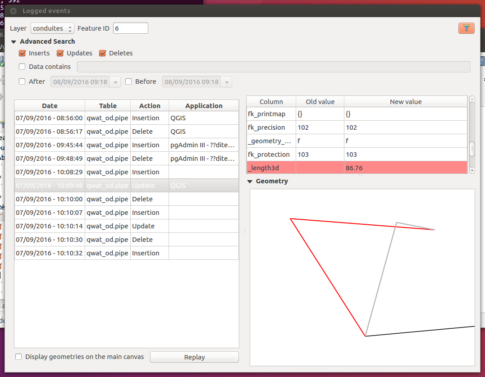

# pg-history-viewer

[](https://plugins.qgis.org/plugins/pg_history_viewer)
[](https://github.com/pre-commit/pre-commit)

QGIS plugin that helps to visualize contents of a PostgreSQL [audit trigger table](https://wiki.postgresql.org/wiki/Audit_trigger).

The main features are:
- visualization of contents of the audit table
- advanced search on the table by means of a SQL query
  - search by type of events (insert, delete, update)
  - search by date
  - free text search in the data
- support geometry display
- replay of an event
- support huge audit table by incremental loading



## Install

### Audit trigger functions

Audit trigger functions are well described here [audit trigger table](https://wiki.postgresql.org/wiki/Audit_trigger).

On the behalf of QWAT's group, new features were added to audit views and replay edits. They are available [Oslandia GitLab repository](https://gitlab.com/Oslandia/audit_trigger).

To install the trigger functions :
* download the [`audit.sql`](https://gitlab.com/Oslandia/audit_trigger/-/blob/master/audit.sql?ref_type=heads) file
* execute the SQL file, either from PgAdmin or PostgreSQL.

To start logging a table, here `qwat_dr.annotationline`:

```sql
SELECT audit.audit_table('qwat_dr.annotationline');
```

or for a view; here `qwat_od.vw_consumptionzone`:

```sql
SELECT audit.audit_view('qwat_od.vw_consumptionzone', 'true'::boolean, '{}'::text[], '{id}'::text[]);
```

### QGIS plugin

QGIS plugin can be installed either from :
* the [QGIS plugin installer](https://plugins.qgis.org/plugins/pg_history_viewer)
* or by downloading this source code

and unzipping it to your QGIS plugin profile or additional plugin paths. See [the QGIS documentation](https://docs.qgis.org/latest/en/docs/user_manual/plugins/plugins.html).

## Credits

* This plugin is inspired by [the Postgres 91 plus Auditor](https://github.com/3nids/postgres91plusauditor) QGIS plugin from Denis.
* This Oslandia audit version was based originally on [2nd Quandrant's source repository](https://github.com/2ndQuadrant/audit-trigger).
